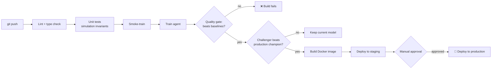
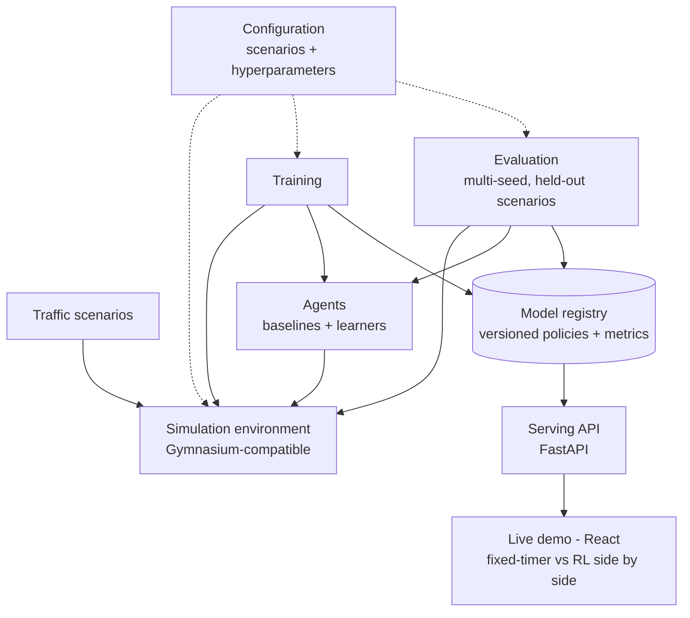

# 🚦 Smart-Traffic-RL

**Adaptive traffic signal control with reinforcement learning, shipped through a production-style MLOps CI/CD pipeline.**


> **Status:** This project is under active development and is being built in public, stage by stage.
> The [Roadmap](#-roadmap) shows what is done and what comes next. Results are published only once they are measured.

---

## 📌 Overview

| | |
|---|---|
| **What** | An RL agent that learns *when to switch traffic lights* at an intersection, so cars wait less than they would under a fixed-timer light. |
| **Why it matters** | Most traffic lights run on fixed schedules that ignore real-time demand, which wastes drivers' time and fuel and adds emissions at every red light that has no traffic crossing against it. |
| **What makes it different** | The model is **not** a notebook. Every change goes through an automated pipeline that **trains the agent, evaluates it against baselines, blocks it if it isn't good enough, and deploys it only if it beats the model currently in production.** |
| **Concepts covered** | Reinforcement learning · Simulation design · Experimental methodology · Python software engineering · Testing · CI/CD · MLOps · Docker · REST APIs · Cloud deployment |

---

## 🧩 The problem

A fixed-time traffic light gives each direction the same green time whatever the traffic is doing.
At 8 a.m., when the main road is backed up and the side street is empty, cars on the main road wait at a red light that serves nobody.

**Goal:** build a controller that observes the intersection and decides, second by second, whether to keep or switch the current light, minimizing how long vehicles wait while staying fair to every direction.

Simple rules ("switch when a queue is long") are hard to tune and break when traffic patterns change.
Reinforcement learning lets the controller **learn the strategy from experience** in simulation instead of having it hand-coded.

---

## 🧠 Approach: framing the problem as reinforcement learning

```
        ┌──────────── action: keep / switch the light ───────────┐
        │                                                        ▼
   ┌─────────┐                                           ┌───────────────┐
   │  AGENT  │◀──── state: queues, current phase, timer ─│  INTERSECTION │
   │         │◀──── reward: how much waiting occurred  ──│  SIMULATION   │
   └─────────┘                                           └───────────────┘
```

| RL element | Meaning in this project |
|---|---|
| **Environment** | A simulated intersection with stochastic (Poisson) vehicle arrivals per lane |
| **Agent** | The traffic-signal controller |
| **State** | What the controller can observe, e.g. queue lengths, the active phase, time since the last switch |
| **Action** | Keep the current phase or switch to the next one |
| **Reward** | A signal tied to vehicle waiting time, designed to discourage starving any one direction |
| **Constraints** | Real-world safety rules such as minimum green time and yellow transitions |

The exact formulation (state features, reward function, constraints) is documented with its reasoning and trade-offs in `DESIGN.md`.

---

## 🤖 Algorithms

The project compares learned policies against strong non-learning baselines, because an RL result only means something next to a baseline.

| Tier | Method | Purpose |
|---|---|---|
| Baseline | **Fixed-time controller** | What most real intersections use; the minimum bar to beat |
| Baseline | **Random controller** | Sanity check for the environment and evaluation code |
| Baseline | **Greedy / actuated rule** (e.g. longest queue first) | The *honest* benchmark: a sensible hand-written policy |
| Learned | **Tabular Q-Learning** | Interpretable value-based learning on a discretized state space |
| Learned (stretch) | **DQN** | Neural-network Q-function with experience replay and a target network |
| Learned (stretch) | **PPO** | Actor-critic policy-gradient method for continuous observations |

---

## 🔁 What makes this an MLOps project

In normal software, CI asks *"does the code work?"*
For ML systems it also has to ask *"is the model good enough, and better than what's in production?"*



### Pipeline stages

| Stage | Trigger | What it checks |
|---|---|---|
| **Code quality** | Every push / PR | Linting, formatting, static typing |
| **Unit tests** | Every push / PR | Simulation invariants (no negative queues, vehicle conservation, no cars crossing on red), determinism under fixed seeds, agent interface contracts |
| **Smoke training** | Every push / PR | Training loop runs end to end; models save and reload correctly |
| **Model quality gate** | Merge to `main` | Trained agent must beat the baselines by a defined margin across multiple seeds on held-out traffic scenarios |
| **Champion vs. challenger** | Merge to `main` | New model is promoted only if it outperforms the model currently deployed |
| **Containerization** | After gate passes | Reproducible Docker image of the serving API |
| **Continuous Delivery** | After image builds | Automatic deploy to **staging**, then a **human approval** step before **production** |
| **Rollback** | On demand | Restore the previous champion model |

---

## 🏗️ System architecture



**Design principles**
- **One shared agent interface**: every controller, from fixed-timer to PPO, maps *state → action* the same way, so any two can be compared directly.
- **One-way dependencies**: the environment knows nothing about agents, and the serving API never imports training code.
- **Configuration over code**: traffic scenarios and hyperparameters live in config files, not in source code.
- **Reproducibility by design**: the same seed and the same config always give the same result, which CI depends on.

---

## 📊 Evaluation methodology

- **Held-out scenarios**: agents are evaluated on traffic patterns they did not train on (e.g. balanced flow, asymmetric main/side road, rush-hour surges).
- **Multiple random seeds**: results are reported as mean ± spread, not a single lucky run.
- **Multiple metrics**: average waiting time, worst-case waiting time, queue length, and throughput, so an improvement on one metric can't hide a regression on another.
- **Every baseline, every time**: learned agents are always reported next to the fixed, random, and greedy controllers.

### Results

| Controller | Avg. wait (s) | Max wait (s) | Throughput (veh/min) |
|---|---|---|---|
| Fixed-time | *pending* | *pending* | *pending* |
| Random | *pending* | *pending* | *pending* |
| Greedy (longest queue) | *pending* | *pending* | *pending* |
| Q-Learning | *pending* | *pending* | *pending* |

*This table is filled in by the evaluation pipeline once the corresponding stages are complete.*

---

## 🛠️ Tech stack

### Languages

| Language | Used for |
|---|---|
| **Python 3.11+** | Simulation environment, agents, training, evaluation, serving API, tests |
| **JavaScript (ES6+)** | Interactive front-end logic and the animated intersection visualization |
| **React** | Component-based UI for the live demo (fixed-timer vs. RL side by side, metrics panels) |
| **HTML5** | Page structure; `<canvas>` rendering of the intersection |
| **CSS3** | Styling and responsive layout of the demo |
| **Node.js** | Front-end tooling: dependency management (npm), dev server, production build |
| **YAML** | GitHub Actions workflows, traffic-scenario and hyperparameter configuration |
| **Bash** | Shell commands in CI/CD workflow steps and helper scripts |
| **Dockerfile** | Reproducible container builds for the API and front-end |
| **Markdown** | Documentation: README, design document |

### Tools & frameworks

| Area | Tools |
|---|---|
| RL & numerics | NumPy, Gymnasium, PyTorch / Stable-Baselines3 (deep RL stages) |
| Configuration | YAML, Pydantic |
| Testing & quality (Python) | pytest, Ruff, mypy |
| Testing & quality (front-end) | ESLint, Prettier, Vitest |
| Serving | FastAPI, Uvicorn |
| Front-end | React, Vite, HTML5 Canvas |
| Packaging | Docker |
| CI/CD | GitHub Actions (environments, protected deployments, secrets, artifacts) |
| Hosting | Render |

---

## 🗺️ Roadmap

- [ ] **Stage 1:** Design document, simulation environment, fixed-time and random baselines
- [ ] **Stage 2:** Continuous Integration: lint, type check, unit tests on GitHub Actions
- [ ] **Stage 3:** Evaluation framework and greedy baseline; seeded, deterministic tests
- [ ] **Stage 4:** Tabular Q-Learning agent; smoke-training and model artifacts
- [ ] **Stage 5:** ML quality gate in CI (must beat baselines across seeds)
- [ ] **Stage 6:** FastAPI serving layer and Docker image
- [ ] **Stage 7:** Continuous Delivery to Render: staging → manual approval → production
- [ ] **Stage 8:** Champion/challenger model promotion and rollback
- [ ] **Stage 9 (stretch):** DQN/PPO agents, rush-hour scenarios, SUMO integration, animated live demo

---

## 📖 What this project explores

- **Reinforcement learning:** MDP formulation, reward design and reward-hacking mitigation, exploration vs. exploitation, value-based and policy-gradient methods
- **Experimental rigor:** baselines, held-out evaluation, multi-seed statistics, multi-metric reporting
- **Software engineering:** modular architecture, clear interfaces, configuration management, type safety
- **Testing:** invariant-based tests for a stochastic simulator, deterministic seeding, contract tests
- **DevOps / MLOps:** CI pipelines, model quality gates, model versioning, champion/challenger promotion, containerization, staged deployments with approvals, rollback
- **Product thinking:** turning a real-world problem into a measurable objective and a usable demo

---

## ⚠️ Known limitations

- **Sim-to-real gap:** the agent learns from a simplified simulation; real deployment would need realistic simulators (e.g. SUMO) and real sensor data.
- **Single intersection:** coordinating multiple intersections is a multi-agent RL problem and is outside the initial scope.
- **Simplified traffic model:** v1 leaves out pedestrians, turning lanes, and emergency-vehicle priority.

---

## 📚 References

- Sutton & Barto, *Reinforcement Learning: An Introduction* (2nd ed.)
- Wei et al., *A Survey on Traffic Signal Control Methods* (2019), arXiv:1904.08117
- Sato, Wider & Windheuser, *Continuous Delivery for Machine Learning* (martinfowler.com)
- Google Cloud, *MLOps: Continuous delivery and automation pipelines in machine learning*
- [Gymnasium](https://gymnasium.farama.org) · [Stable-Baselines3](https://stable-baselines3.readthedocs.io) · [SUMO](https://eclipse.dev/sumo)

---

## 📄 License

Released under the [MIT License](LICENSE).

---

## 👩‍💻 Author

**Aaditi Singhal**: [github.com/aaditisinghal](https://github.com/aaditisinghal)

*Feedback and questions are welcome. Feel free to open an issue.*
